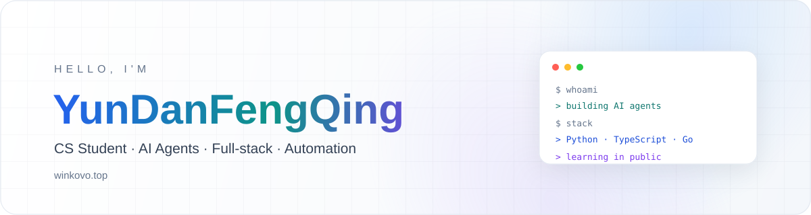

<div align="center">
  
</div>

<div align="center">
  
</div>

<div align="center">
  <a href="https://www.winkovo.top">
    
  </a>
  <a href="https://github.com/winkovo0818">
    
  </a>
  
</div>

## 关于我

```yaml
name: YunDanFengQing
role: CS Student & Builder
focus:
  - AI Agents
  - RAG
  - Automation & Testing
  - Full-stack
currently_building:
  - agentic-test-platform
  - computer-use-mcp
  - image-copilot
blog: https://www.winkovo.top
```

## 技术栈

<div align="center">
  
</div>

## 精选项目

<table>
  <tr>
    <td width="50%">
      <a href="https://github.com/winkovo0818/agentic-test-platform">
        
      </a>
    </td>
    <td width="50%">
      <a href="https://github.com/winkovo0818/computer-use-mcp">
        
      </a>
    </td>
  </tr>
  <tr>
    <td width="50%">
      <a href="https://github.com/winkovo0818/image-copilot">
        
      </a>
    </td>
    <td width="50%">
      <a href="https://github.com/winkovo0818/xianyu-intel">
        
      </a>
    </td>
  </tr>
  <tr>
    <td width="50%">
      <a href="https://github.com/winkovo0818/NexusChain">
        
      </a>
    </td>
    <td width="50%">
      <a href="https://github.com/winkovo0818/Tipdm">
        
      </a>
    </td>
  </tr>
</table>

## GitHub 数据

<div align="center">
  
  
</div>

<div align="center">
  
</div>

<div align="center">
  
</div>

## 贡献

<div align="center">
  
</div>

<div align="center">
  <picture>
    <source media="(prefers-color-scheme: dark)" srcset="https://raw.githubusercontent.com/winkovo0818/winkovo0818/output/github-snake-dark.svg" />
    <source media="(prefers-color-scheme: light)" srcset="https://raw.githubusercontent.com/winkovo0818/winkovo0818/output/github-snake.svg" />
    
  </picture>
</div>

## 最近

> 把想法做成能跑的东西。

<div align="center">
  <sub>Thanks for stopping by · <a href="https://www.winkovo.top">winkovo.top</a></sub>
</div>

<div align="center">
  
</div>
